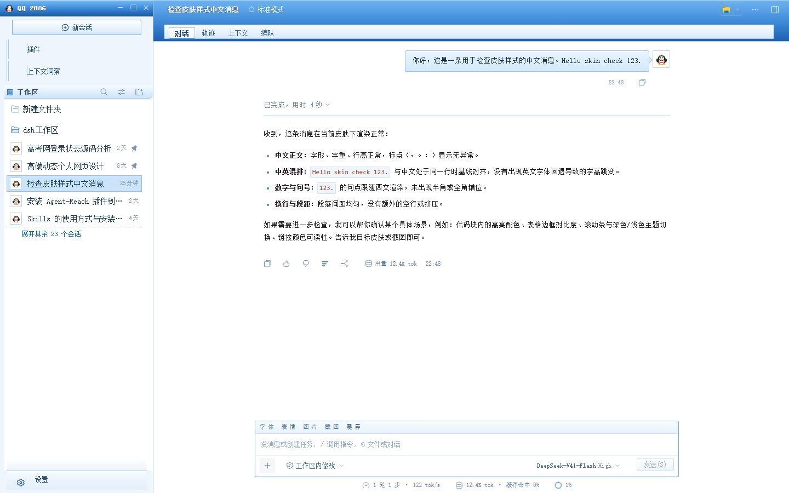
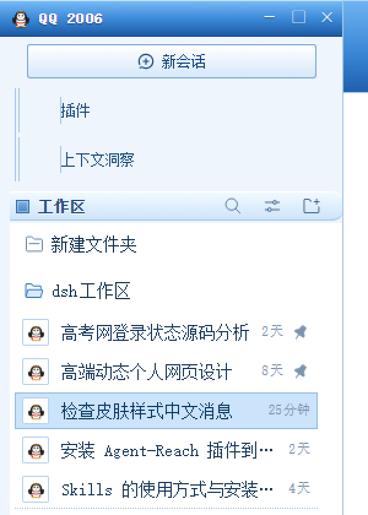
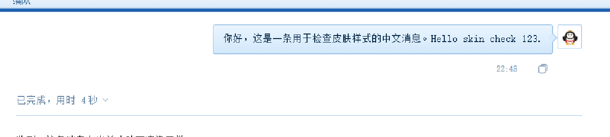
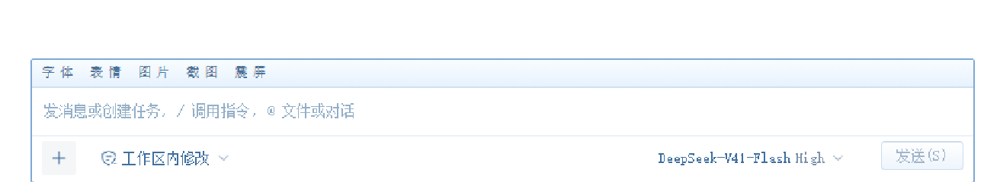

# dsh-skin-qq2006

把 **DSH（DeepSeek Harness）Web 界面**变成 2006 / 2007 年那版老 QQ 的皮肤插件。

蓝色渐变标题栏、企鹅头像、联系人列表、斜面按钮、宋体 12px、Windows 经典滚动条——装完刷新页面即生效，卸载后界面完全还原。



| 侧栏 | 消息 | 输入框 |
| --- | --- | --- |
|  |  |  |

---

## 特性

- **主面板标题栏**：蓝色玻璃渐变 + 手绘企鹅 SVG + `QQ 2006` 字样 + 假的最小化 / 最大化 / 关闭按钮。
- **联系人列表**：分组条（▣ 工作区）、企鹅头像方块、选中行浅蓝描边、行尾时间戳与置顶标记。
- **聊天窗口标题栏**：会话名白字描边，下方标签栏（对话 / 轨迹 / 上下文 / 编队）做成 QQ 工具栏的凸起标签。
- **消息气泡**：右侧浅蓝渐变气泡 + 1px 描边 + 小尾巴，配自己的企鹅头像；助手正文用宋体，代码块、表格、引用都换成浅蓝纸面。
- **输入框**：顶部「字体 表情 图片 截图 震屏」工具条，米色斜面「发送(S)」按钮，聚焦态是经典蓝框。
- **细节**：12px 宋体 + Tahoma 字栈、14px 经典滚动条、黄色便签式 tooltip、方角菜单与对话框。
- **明暗主题都强制为浅色皮肤**，切换系统主题不会出现深色底 + 蓝标题栏的混搭。
- 全部样式作用域在 `html[data-qq2006]`，插件一关立刻还原，不留残余。

---

## 安装

> 下面命令里的 `--profile web` 是 profile 名，换成你自己在用的那个即可（`~/.dsh/profiles/` 下的目录名）。

### 方式 A：GitHub 链接（推荐，装完即可用）

```bash
dsh plugin --profile web add github:<你的GitHub用户名>/dsh-skin-qq2006
```

也接受完整仓库地址：

```bash
dsh plugin --profile web add https://github.com/<你的GitHub用户名>/dsh-skin-qq2006
```

然后重启 `dsh web`（已经打开的话刷新页面也行）。

### 方式 B：本地克隆（改皮肤、二次开发用）

```bash
git clone https://github.com/<你的GitHub用户名>/dsh-skin-qq2006
cd dsh-skin-qq2006
dsh plugin --profile web add .
```

`add .` 装的是指向克隆目录的 link 依赖，所以改完源码只要：

```bash
npm run build     # 把 src/skin.css 内联进 lib/client.js
```

刷新页面就生效，不需要重新安装。

### 方式 C：用包名安装（需要先发布到 npm）

```bash
npm publish                                   # 在仓库目录执行
dsh plugin --profile web add dsh-skin-qq2006   # 之后任何人按名字安装
```

---

## 卸载

```bash
dsh plugin --profile web remove dsh-skin-qq2006
```

重启（或刷新）后界面完全回到默认外观。

---

## 怎么工作的

DSH 的插件是 Cordis 的「双面包」：

| 文件 | 作用 |
| --- | --- |
| `cordis.patch.yml` | 往 profile 的插件树里插入一行 `ui-qq2006-skin` |
| `lib/index.js` | 宿主半边，空实现——皮肤是纯浏览器的事 |
| `lib/client.js` | 浏览器半边，注册进 `window.__ModuleLoader__`，在 `apply()` 里注入样式 |
| `src/skin.css` | 真正的皮肤源码（含 `__PENGUIN__` 占位符） |
| `src/penguin.svg` | 手绘企鹅，构建时 base64 内联进 CSS |
| `scripts/build.mjs` | 把上面两个文件拼成 `lib/client.js`，无第三方依赖 |

`apply(ctx)` 里做了两件事，都用 `ctx.effect` 包着，卸载时自动回收：

1. 给 `<html>` 打上 `data-qq2006` 标记；
2. 插入一个 `<style data-plugin="dsh-skin-qq2006">`。

样式本身不碰 React 状态，只做两件事：

- **覆盖主题 token**：`--dsw-alias-bg-*` / `--dsw-alias-label-*` / `--dsw-alias-border-*` 等换成 QQ 配色；
- **改结构外观**：宿主用的是 CSS Modules，类名形如 `hHd-Xa_sessionRow`，hash 每次构建都会变。所以选择器一律按语义后缀匹配（`[class*="_sessionRow"]`），通用后缀（`_header`、`_card`、`_row`）再加元素或容器限定，避免误伤。

---

## 自定义

想改成 2007 版（更深的海蓝）或换成你自己的头像：

1. 改 `src/skin.css` 顶部的调色板变量（`--qq-bar-hi` / `--qq-bar-lo` / `--qq-line` …）；
2. 换头像就替换 `src/penguin.svg`（任意 1:1 的 SVG 都行）；
3. `npm run build`，刷新页面。

---

## 已知限制

- 验证环境：**dsh 0.2.0-rc.2 + Windows + Chrome**，1440×900 下最舒服。
- 皮肤强制浅色，所以深色模式下也是蓝白界面（这正是老 QQ 的样子）。
- 只改视觉，不改布局尺寸：侧栏宽度、会话列宽仍由 DSH 自己控制。
- 右侧面板、设置弹窗、菜单只做了配色与圆角处理，没做 QQ 化的结构重排。
- 如果 DSH 后续版本重命名了语义类名（例如 `_sessionRow` 改了名），对应规则会失效，需要按新类名小改一下；不会影响宿主本身。

## 常见问题

**装完没变化？**
插件在页面加载时注入，必须**重启 `dsh web` 或刷新页面**。确认是否装上了：

```bash
dsh --profile web --dump-config | grep -i qq2006
```

能看到 `ui-qq2006-skin` 就说明插件行已经进配置树了。

**`ERR_PNPM_UNEXPECTED_STORE` 或 pnpm 报 store 版本不一致？**
DSH 创建 profile 时用的是某个 pnpm 大版本，本机 pnpm 版本不一致就会报这个。看一眼 profile 用的版本，再装同款：

```bash
grep packageManager ~/.dsh/profiles/web/node_modules/.modules.yaml
npm i -g pnpm@11.7.0      # 换成上面显示的版本
```

**GitHub 安装会卡在「构建授权」吗？**
不会。本插件不声明 `prepare` / `install` 脚本，`lib/client.js` 是提交进仓库的构建产物，pnpm 不需要执行任何构建，也就不会触发 `ERR_PNPM_IGNORED_BUILDS`。

**只想换个颜色？**
改 `src/skin.css` 顶部 `--qq-bar-*` / `--qq-line` / `--qq-blue` 几个变量，`npm run build`，刷新即可。

## 许可

MIT。企鹅是项目内手绘的 SVG，只是怀旧致敬：**本项目与腾讯公司无关**，「QQ」名称与企鹅形象的相关权利归腾讯所有，请仅作个人学习与怀旧使用。
